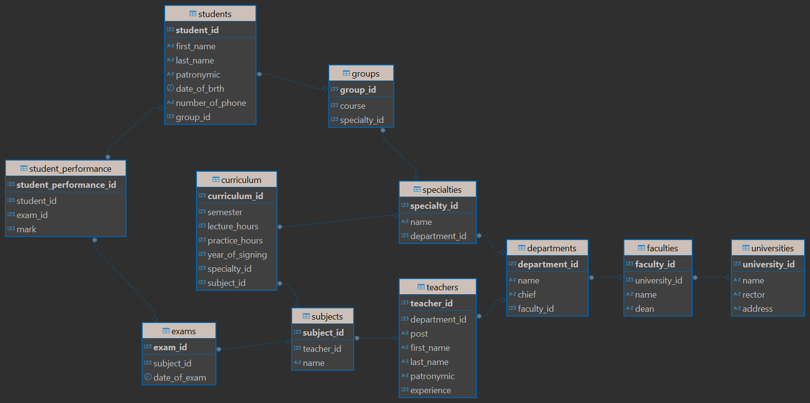

# База данных Университета

Учебный проект по проектированию реляционной базы данных и разработке бизнес-логики на уровне СУБД.

## Задача проекта
Спроектировать логическую и физическую модель данных для автоматизации учебного процесса, описать бизнес-правила и реализовать серверную логику на уровне СУБД.

## Стек и инструменты
* **СУБД:** PostgreSQL
* **Инструмент:** DBeaver
* **Языки:** SQL, PL/pgSQL
* **Контроль версий:** Git

## Структура репозитория
* `schema.sql` — DDL-скрипт для создания структуры базы данных (11 таблиц).
* `seed_data.sql` — скрипт для наполнения базы тестовыми данными.
* `triggers.sql` — функции и триггеры для валидации данных и аудита.
* `views.sql` — представления (обычные и материализованные).
* `queries.sql` — набор SQL-запросов для аналитики и отчетности.

## Реализованная модель данных
В базе данных реализовано 11 сущностей. На уровне БД заложены бизнес-правила: 
* Запрет на создание учебного плана с нагрузкой более 144 часов (реализовано через триггер).
* Защита от удаления предметов, которые уже привязаны к учебному плану.
* Логирование действий (аудит добавления преподавателей и отчисления студентов).

## Оптимизация и аналитика
В проекте реализованы материализованные представления с индексами для кэширования тяжелых запросов. Файл `queries.sql` содержит аналитические запросы с использованием `JOIN`, `GROUP BY`, `HAVING`, подзапросов и оконных функций (`RANK`) для решения бизнес-задач.

## Документация и схемы
* **ER-диаграмма базы данных** — 
